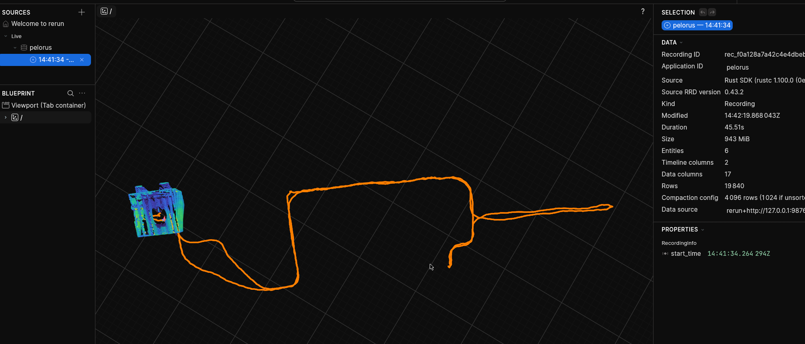
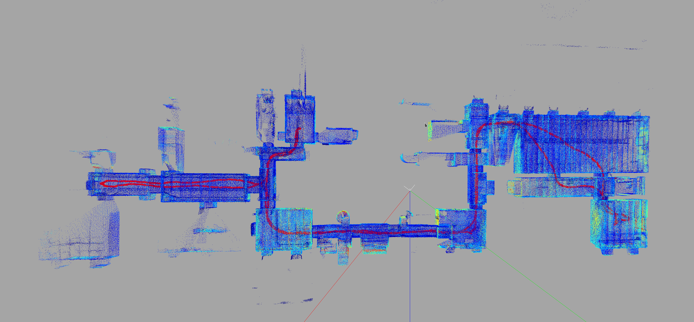
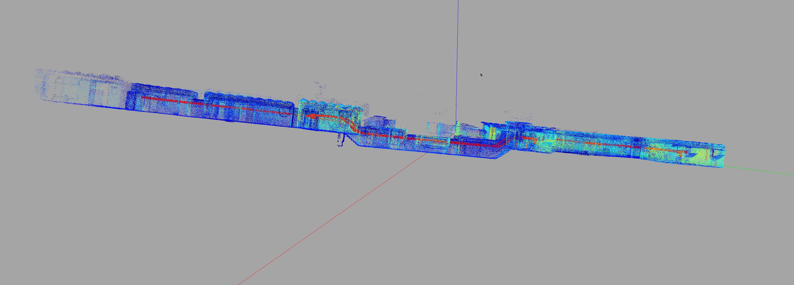

# Pelorus to HDMapping simplified instruction

**Note:** Pelorus is a LiDAR-inertial odometry. It runs offline on the CPU:
its bag player Minot hands it the next scan only when the previous one is
processed, so a run never drops a scan; Pelorus itself takes about a minute
for reg-1. You watch it in a Rerun viewer instead of RViz.

Pelorus uses the author's defaults, except for the Livox Mid-360 settings
(topics, point layout, IMU position) and the minimum point range, set to the
Mid-360 blind zone of 0.5 m (default 4 m), see
[overlay/config/pelorus_bunker.rl](overlay/config/pelorus_bunker.rl).

## Step 1 (prepare data)
Download the dataset `reg-1.bag` by clicking [link](https://cloud.cylab.be/public.php/dav/files/7PgyjbM2CBcakN5/reg-1.bag) or from the [Zenodo](https://zenodo.org/records/23069933) mirror (it is part of [Bunker DVI Dataset](https://charleshamesse.github.io/bunker-dvi-dataset)).

On Zenodo the bag archive is split into `reg-1.zip.part-000`, `reg-1.zip.part-001`, etc.,
download all parts, then merge and extract them:

```bash
cd ~/Downloads
cat reg-1.zip.part-0* > full.zip
zip -F full.zip --out full-fixed.zip
unzip full-fixed.zip
```

File `reg-1.bag` is an input for further calculations.
It should be located in `~/hdmapping-benchmark/data`.

## Step 2 (prepare docker)
```shell
mkdir -p ~/hdmapping-benchmark
cd ~/hdmapping-benchmark
git clone https://github.com/MapsHD/benchmark-Pelorus-to-HDMapping.git --recursive
cd benchmark-Pelorus-to-HDMapping
git checkout Bunker-DVI-Dataset-reg-1
docker build -t pelorus_standalone .
```

The first build compiles Pelorus from source and takes a while.

## Step 3 (run docker, file `reg-1.bag` should be in `~/hdmapping-benchmark/data`)
```shell
cd ~/hdmapping-benchmark/benchmark-Pelorus-to-HDMapping
chmod +x docker_session_run-pelorus.sh
cd ~/hdmapping-benchmark/data
~/hdmapping-benchmark/benchmark-Pelorus-to-HDMapping/docker_session_run-pelorus.sh reg-1.bag .
```

The script first converts the Livox LiDAR messages of `reg-1.bag` to
`PointCloud2` (as [livox_bag_aggregate](https://github.com/MapsHD/livox_bag_aggregate)
does) and writes them with the IMU into an MCAP bag in
`~/hdmapping-benchmark/data/pelorus-input`. This reads the whole bag and takes
a few minutes; later runs reuse it.

While the bag is processed you can watch Pelorus live in the Rerun viewer: the
current scan coloured by intensity and the trajectory as an orange line. The
time panel at the bottom scrubs back through the run. Closing the viewer does
not stop Pelorus; to run without it, put `VIS=0` in front of the command. The
viewer uses the GPU when one is found, otherwise the CPU (slower); Pelorus
itself always runs on the CPU. The orange "Docker" mark in the viewer's top bar
is Rerun's notice that it runs in a container, nothing to fix.



## Step 4 (Open and visualize data)
Expected data should appear in `~/hdmapping-benchmark/data/output_hdmapping-pelorus`.
Use tool [multi_view_tls_registration_step_2](https://github.com/MapsHD/HDMapping) to open `session.json` from `~/hdmapping-benchmark/data/output_hdmapping-pelorus`.





You should see the following data in folder `~/hdmapping-benchmark/data/output_hdmapping-pelorus`:

lio_initial_poses.reg

poses.reg

scan_lio_*.laz

session.json

trajectory_lio_*.csv

## Contact email
januszbedkowski@gmail.com
